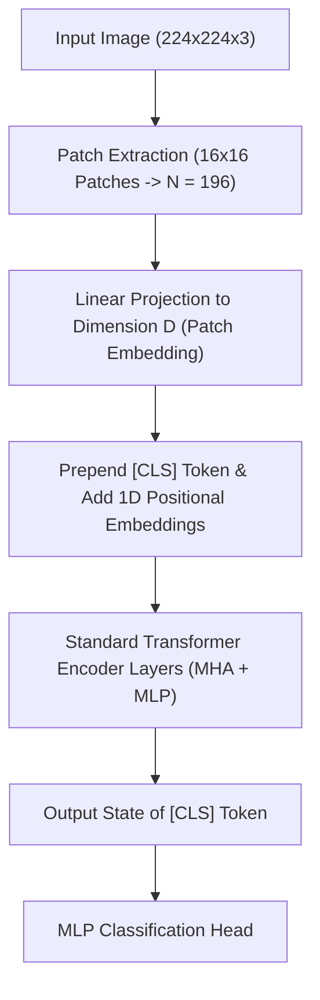

# Thị Giác Máy Tính Dựa Trên Transformer (Vision Transformers & Swin Transformer)

> **Khái niệm chính thống**: Dosovitskiy et al. (ICLR 2021) *"An Image is Worth 16x16 Words: Transformers for Image Recognition at Scale"*; Liu et al. (ICCV 2021) *"Swin Transformer: Hierarchical Vision Transformer using Shifted Windows"*; *Deep Learning for Computer Vision*, Chapter 8.
> **Miền kiến thức**: [[index|Modern Vision Architectures & Attention]]
> **Tài liệu gốc liên quan**:
> - [AIO_Solution_Swin_CNN.pdf](../resources/deep-learning/computer-vision/AIO_Solution_Swin_CNN.pdf) (Trang 1-10)
> - [Deep Learning_Computer Vision_NLP.pdf](../resources/deep-learning/Deep%20Learning_Computer%20Vision_NLP.pdf) (Trang 220-250)
> - [Classification - CNN.pdf](../resources/deep-learning/computer-vision/Classification%20-%20CNN.pdf) (Trang 60-73)

---

## 1. Tóm tắt (Executive Summary)
**Vision Transformers (ViT)** đánh dấu bước ngoặt lịch sử khi áp dụng trực tiếp kiến trúc Transformer nguyên bản của xử lý ngôn ngữ tự nhiên vào thị giác máy tính mà hầu như không cần chỉnh sửa cấu trúc. Bằng cách chia nhỏ bức ảnh thành chuỗi các mảnh vá (**Patches**) có kích thước cố định (ví dụ $16 \times 16$) và xem mỗi patch như một "token từ ngữ", ViT khai thác sức mạnh của cơ chế Global Self-Attention để mô hình hóa mối quan hệ giữa mọi vùng trên ảnh. Tiếp nối ViT, kiến trúc **Swin Transformer (Shifted Windows)** đã giải quyết bài toán độ phức tạp tính toán bậc hai bằng cách tính toán Attention trong các cửa sổ cục bộ phân tầng và hoán vị cửa sổ, đưa Vision Transformer trở thành xương sống (Backbone) đa năng cho mọi tác vụ từ phân loại, phát hiện vật thể đến phân đoạn ảnh.

---

## 2. Định nghĩa chính thống & Cơ chế Patch Embedding

### 2.1 Từ Bức ảnh đến Chuỗi Token (ViT Ingestion)
Cho ảnh $I \in \mathbb{R}^{H \times W \times C}$ với kích thước patch là $P \times P$:
1. Số lượng patch thu được: $N = \frac{HW}{P^2}$.
2. Mỗi patch được duỗi phẳng (flatten) thành vector kích thước $P^2 \cdot C$, sau đó chiếu tuyến tính qua ma trận $E \in \mathbb{R}^{(P^2 \cdot C) \times D}$ để thu được vector nhúng có số chiều $D$:
   $$z_0 = [x_{\text{class}}; \; x_p^1 E; \; x_p^2 E; ...; \; x_p^N E] + E_{pos}$$
3. Thêm một token học được đặc biệt $[x_{\text{class}}]$ vào đầu chuỗi (tương tự token `[CLS]` của BERT) và cộng vector mã hóa vị trí 1D học được ($E_{pos} \in \mathbb{R}^{(N+1) \times D}$).
4. Chuỗi vector được đưa qua các khối Transformer Encoder chuẩn mực. Trạng thái ẩn cuối cùng của token `[CLS]` được dùng làm đầu vào cho bộ phân loại (MLP Head).

### 2.2 Đột phá Swin Transformer: Shifted Window Attention
ViT nguyên bản có độ phức tạp tính toán $\mathcal{O}((HW)^2)$ theo độ phân giải ảnh, khiến nó bất khả thi cho các ảnh độ phân giải cao trong phát hiện vật thể.
Swin Transformer giải quyết vấn đề này qua hai cơ chế:
1. **Window Multi-Head Self-Attention (W-MSA)**: Chia ảnh thành các cửa sổ kích thước $M \times M$ không chồng lấn (thường $M=7$). Chỉ tính Self-Attention bên trong từng cửa sổ, đưa độ phức tạp về mức tuyến tính $\mathcal{O}(HW \cdot M^2)$.
2. **Shifted Window Multi-Head Self-Attention (SW-MSA)**: Ở tầng tiếp theo, dịch chuyển vị trí các cửa sổ đi $\left(\lfloor \frac{M}{2} \rfloor, \lfloor \frac{M}{2} \rfloor\right)$ pixels. Cơ chế dịch chuyển này cho phép thông tin giao tiếp xuyên qua ranh giới của các cửa sổ cũ mà vẫn giữ nguyên chi phí tính toán tuyến tính.

---

## 3. So sánh & Mâu thuẫn / Sắc thái giữa các tài liệu

| Tiêu chí | Convolutional Neural Network (ResNet) | Vision Transformer (ViT) | Swin Transformer |
| :--- | :--- | :--- | :--- |
| **Định kiến quy nạp (Inductive Bias)** | Rất mạnh (giả định tính cục bộ và bất biến tịnh tiến). | Rất yếu (mô hình phải tự học cấu trúc hình học từ dữ liệu). | Trung bình khá (đưa tính cục bộ phân tầng trở lại). |
| **Yêu cầu dữ liệu huấn luyện** | Học tốt trên tập dữ liệu nhỏ và vừa (ImageNet-1k). | Cần dữ liệu khổng lồ (JFT-300M) nếu không sẽ bị underfit/overfit nghiêm trọng. | Học tốt trên ImageNet-1k nhờ cấu trúc cửa sổ. |
| **Độ phức tạp theo phân giải ảnh** | Tuyến tính $\mathcal{O}(HW)$. | Bậc hai $\mathcal{O}((HW)^2)$. | Tuyến tính $\mathcal{O}(HW)$. |
| **Độ đa năng cho bài toán Downstream** | Tốt cho mọi bài toán (Dense Prediction). | Kém trên Object Detection/Segmentation vì độ phân giải cố định. | **Xuất sắc nhất**; làm backbone thay thế ResNet trong toàn bộ mô hình SOTA. |

---

## 4. Góc nhìn Thực chiến & Thiết kế Hệ thống cho AI Engineer

### 4.1 Triển khai ViT trong Môi trường Hạn chế Tài nguyên
- Không bao giờ huấn luyện ViT từ đầu (from scratch) trên tập dữ liệu đặc thù của công ty nếu số lượng ảnh dưới 100.000 mẫu.
- Luôn sử dụng kỹ thuật **Transfer Learning**: Lấy checkpoint tiền huấn luyện (pretrained weights từ HuggingFace/timm) và chỉ tinh chỉnh (fine-tuning) các tầng cuối cùng hoặc áp dụng LoRA trên các ma trận $W_Q, W_V$ của Transformer.

### 4.2 Câu hỏi phỏng vấn thực tế
- **Q**: *Tại sao phép trích xuất Patch Embedding trong ViT lại có thể được cài đặt tương đương tuyệt đối bằng một lớp Convolution 2D duy nhất?*
  - **A**: Phép trích xuất patch kích thước $P \times P$ và chiếu tuyến tính sang vector $D$ chiều chính là một lớp `nn.Conv2d(in_channels=3, out_channels=D, kernel_size=P, stride=P)`. Do bước trượt `stride` bằng đúng kích thước nhân `kernel_size = P`, các cửa sổ tích chập hoàn toàn không gối lên nhau, tạo ra chính xác $\frac{H}{P} \times \frac{W}{P}$ vector biểu diễn có số chiều $D$. Cách cài đặt này tận dụng tối đa nhân tăng tốc GPU thay vì phải cắt mảng thủ công.

---

## 5. Mạng lưới Liên kết Tri thức (Knowledge Graph & `wiki-links`)
- [[transformer-architecture]] — Bản thiết kế gốc của cơ chế Self-Attention.
- [[convolutional-neural-networks]] — Hệ quy chiếu đối chiếu của ViT trong thị giác máy tính.
- [[object-detection-yolo]] — Swin Transformer làm backbone cho các bộ phát hiện vật thể tiên tiến.
- [[inference-optimization-tensorrt]] — Kỹ thuật biên dịch nhân Attention tối ưu cho ViT trên GPU.